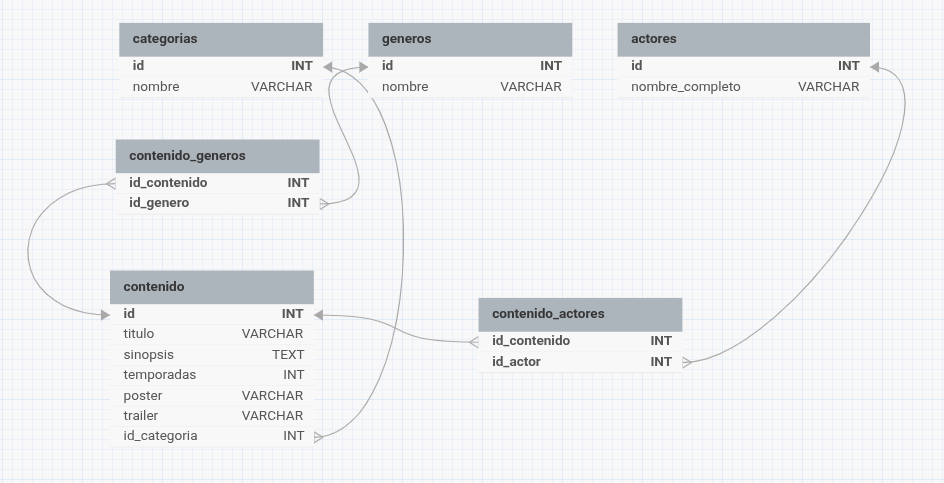

# 🎬 Trailerflix API

Una API REST desarrollada con **Node.js**, **Express**, **Sequelize** y **MySQL** para gestionar un catálogo de películas y series. Este proyecto se enfoca en el modelado relacional, la normalización de datos y la creación de una capa de API clara y ordenada que expone la información de manera estructurada.

Este proyecto fue desarrollado como ejercicio práctico de diseño de bases de datos, SQL, uso de ORM y desarrollo de APIs.

---

## 🚀 Tecnologías utilizadas

- [Node.js](https://nodejs.org/) – entorno de ejecución para JavaScript
- [Express](https://expressjs.com/) – framework web para Node.js
- [Sequelize](https://sequelize.org/) – ORM para bases de datos relacionales
- [MySQL](https://www.mysql.com/) – sistema de gestión de bases de datos
- [MySQL Workbench](https://www.mysql.com/products/workbench/) – herramienta para diseñar y administrar la base de datos
- [dotenv](https://www.npmjs.com/package/dotenv) – gestión de variables de entorno

---

## 📌 Objetivo del proyecto

El objetivo de este proyecto es crear una API funcional para un catálogo tipo streaming donde cada contenido tiene:

- su categoría
- múltiples géneros
- múltiples actores
- una sinopsis
- un trailer
- un poster

Los datos están modelados de manera relacional para evitar duplicación y mantener consistencia. La API expone esa información a través de endpoints que permiten listar, buscar y filtrar el catálogo.

---

## 🗂️ Diseño de la base de datos

La base de datos sigue un modelo relacional normalizado.


### Entidades principales
- `categorias`
- `generos`
- `actores`
- `contenido`

### Tablas de relación
- `contenido_generos`
- `contenido_actores`

### Tipos de relación
- `categoria` -> `contenido` : 1:N
- `contenido` <-> `generos` : N:M
- `contenido` <-> `actores` : N:M

Este diseño permite guardar cada género y cada actor una sola vez, y reutilizarlos en múltiples contenidos.

---

## 🧩 Vista SQL

Una parte clave de la capa de base de datos es la vista `vw_trailerflix`, creada para unificar la estructura del catálogo en una sola consulta. La vista une:

- `contenido`
- `categorias`
- `generos`
- `actores`

y consolida los géneros y el reparto usando `GROUP_CONCAT`.

Esto resulta útil porque la API puede responder con una estructura unificada, sin tener que hacer varias consultas fragmentadas.

---

## 📁 Estructura del proyecto

```bash
trailerflix-api/
├── database/
│   ├── trailerflix_db.sql       # Esquema SQL completo, datos y vista
│   └── trailerflix.json         # Dataset base utilizado para poblar la base de datos
├── public/
│   ├── index.html              # Interfaz web principal
│   ├── styles.css              # Estilos de la demo visual
│   └── app.js                  # Conexión del frontend con la API
├── src/
│   ├── models/
│   │   ├── Categoria.js
│   │   ├── Genero.js
│   │   ├── Actor.js
│   │   ├── Contenido.js
│   │   └── index.js            # Exportación de modelos y relaciones
│   ├── routes/
│   │   └── index.js            # Rutas de la API
│   ├── app.js                  # Configuración del servidor Express
│   ├── database.js             # Conexión a MySQL con Sequelize
│   └── ...
├── .env.example                # Ejemplo de variables de entorno
├── package.json                # Dependencias y comandos del proyecto
├── README.md                  # Documentación del proyecto
└── ...
```

---

## 🔧 Configuración inicial

1. Asegurate de tener **MySQL** instalado y corriendo.
2. Creá una base de datos llamada `trailerflix_db`.
3. Creá un archivo `.env` en la raíz del proyecto con tus credenciales:

```env
DB_NAME=trailerflix_db
DB_USER=root
DB_PASS=tu_contraseña
DB_HOST=localhost
DB_PORT=3306
PORT=3000
```

4. Instalá las dependencias:

```bash
npm install
```

5. Iniciá el servidor:

```bash
npm start
```

6. Importá el esquema SQL desde `database/trailerflix_db.sql` en MySQL Workbench si es necesario.

---

## 📖 Endpoints disponibles

| Método | Ruta | Descripción |
|--------|------|-------------|
| GET | `/` | Interfaz web del catálogo |
| GET | `/api/catalogo` | Devuelve el catálogo completo con categoría, géneros y actores |
| GET | `/api/titulo/:title` | Busca contenido por coincidencia parcial en el título |
| GET | `/api/categoria/:cat` | Filtra contenido por coincidencia parcial en la categoría |
| GET | `/api/reparto/:act` | Busca contenidos asociados a un actor o actriz |
| GET | `/api/trailer/:id` | Devuelve el tráiler de un contenido por su ID |

---

## 🧪 Ejemplos de requests

### Obtener todo el catálogo

```bash
GET /api/catalogo
```

### Buscar por título

```bash
GET /api/titulo/the crown
```

### Filtrar por categoría

```bash
GET /api/categoria/serie
```

### Buscar por actor

```bash
GET /api/reparto/benedict cumberbatch
```

### Obtener tráiler por ID

```bash
GET /api/trailer/123
```

### Buscar contenido por reparto

```bash
GET /api/reparto/ricardo darin
```

Ejemplo de respuesta:

```json
[
  {
    "id": 16,
    "titulo": "Relatos Salvajes",
    "sinopsis": "Seis historias independientes muestran a personas comunes que reaccionan ante situaciones injustas o absurdas.",
    "temporadas": null,
    "poster": "https://placehold.co/600x900/111827/FFFFFF?text=Relatos%20Salvajes",
    "trailer": "https://www.youtube.com/results?search_query=Relatos+Salvajes+trailer+oficial",
    "categoria": { "nombre": "Película" },
    "generos": [
      { "nombre": "Comedia" },
      { "nombre": "Drama" },
      { "nombre": "Suspenso" }
    ],
    "actores": [
      { "nombre_completo": "Ricardo Darín" }
    ]
  }
]
```

Si no se encuentra una coincidencia:

```json
{
  "error": "No se encontró ningún contenido cuyo reparto coincida con: 'actor inexistente'"
}
```

### Obtener el tráiler por ID

```bash
GET /api/trailer/1
```

Ejemplo de respuesta con tráiler disponible:

```json
{
  "id": 1,
  "titulo": "The Crown",
  "trailer": "https://www.youtube.com/results?search_query=The+Crown+trailer+oficial"
}
```

Si el contenido no tiene tráiler:

```json
{
  "id": 5,
  "titulo": "Gambito de Dama",
  "mensaje": "El tráiler no está disponible para este título."
}
```

Si el ID no existe:

```json
{
  "error": "No existe ningún contenido con el id: '999'"
}
```

---

## 🧠 Por qué este proyecto importa

Este proyecto combina varias habilidades muy importantes:

- modelado de bases de datos
- diseño de SQL y restricciones
- pensamiento relacional
- uso de ORM con Sequelize
- construcción de APIs con Express
- configuración de entorno con dotenv
- normalización y mantenimiento de integridad de datos

Es un ejemplo muy representativo de cómo una aplicación real conecta una base relacional con una capa backend.

---

## 🧾 Reflexión del proyecto

Este proyecto no trata solo de crear rutas o tablas. También demuestra la lógica detrás de una buena arquitectura backend:

- separar los datos por responsabilidad
- evitar la duplicación de información
- mantener entidades consistentes
- trabajar con relaciones en vez de estructuras planas
- ofrecer una API limpia para consumir la información

Ese es el centro del ejercicio: construir un backend que respete un modelo relacional sólido.

---

## 🎯 Observaciones finales

Este proyecto es ideal para estudiar:

- diseño de base de datos
- creación de esquemas en MySQL
- asociaciones con Sequelize
- consultas unificadas del catálogo
- diseño de APIs REST con Express

Es un ejemplo práctico de cómo un backend puede transformar un modelo relacional en una API útil y escalable.

---

## 📜 Licencia

Este proyecto está pensado con fines educativos y académicos.

---

